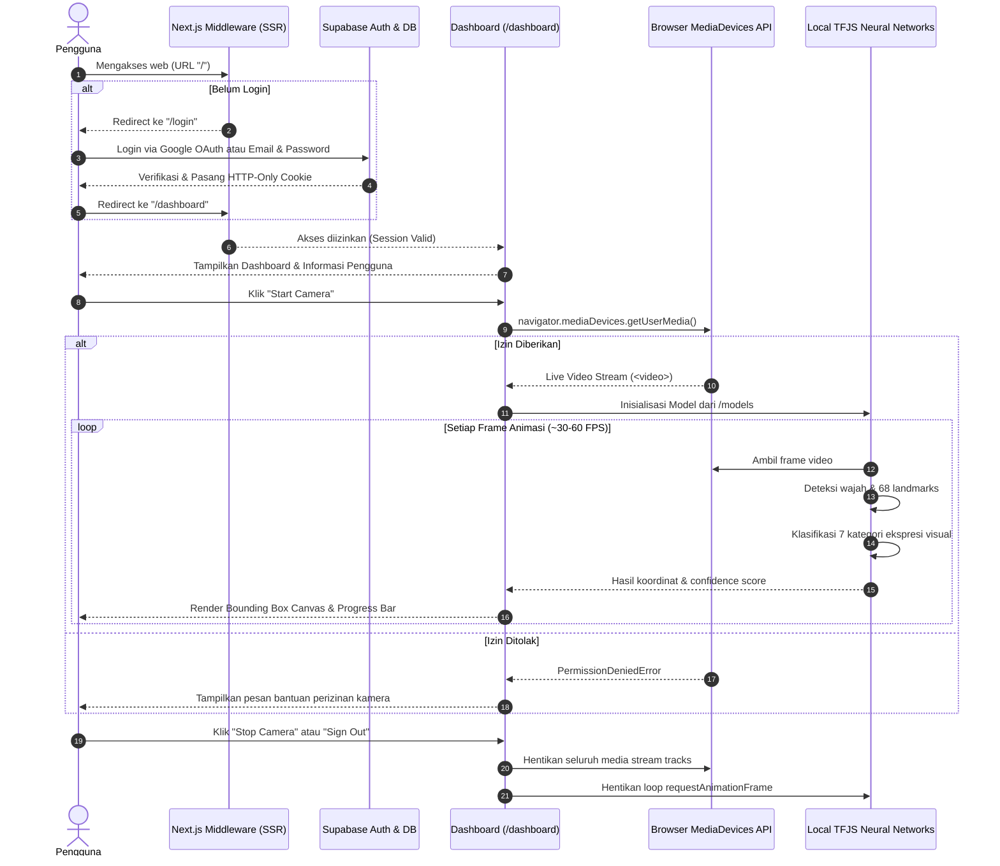

# 🏛️ Arsitektur Sistem & Core User Flow

Dokumen ini menjelaskan arsitektur teknis, pemisahan modul, dan alur autentikasi serta pemrosesan Computer Vision aplikasi.

---

## 🗺️ Diagram Alur Pengguna (Core User Flow)

---

## 📁 Pemisahan Modul Aplikasi (Modular Architecture)

Aplikasi dibangun dengan prinsip pemisahan tanggung jawab yang ketat:

1. **Authentication Module (`src/components/auth/`, `src/lib/supabase/`)**:
   - Menangani Google OAuth, Email/Password login, registrasi, pertukaran callback token, dan manajemen sesi cookie.
2. **Dashboard Module (`src/app/dashboard/`, `src/components/dashboard/`)**:
   - Menampilkan layout dashboard, identitas pengguna, status sistem AI, dan tombol sign-out.
3. **Camera Module (`src/hooks/useCamera.ts`, `src/components/detection/CameraView.tsx`)**:
   - Menangani siklus hidup stream kamera, izin peramban, pemilihan resolusi, dan pembersihan memori (*cleanup*).
4. **Face Detection & Expression Module (`src/lib/faceApi.ts`, `src/hooks/useFaceExpressionDetection.ts`, `src/components/detection/ExpressionResultsPanel.tsx`)**:
   - Memuat bobot neural network dari `/models`, menjalankan inferensi per frame, menggambar kanvas visual, dan menampilkan distribusi probabilitas ekspresi.
5. **Shared UI Components (`src/components/ui/`)**:
   - Tombol, kartu, badge, progress bar, dan dialog yang konsisten tanpa "AI slop".
