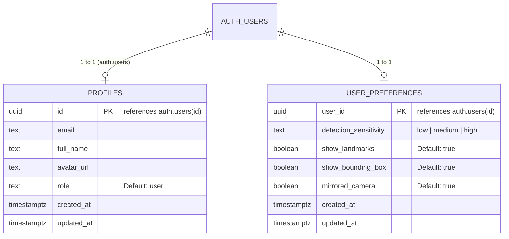

# 🗄️ Database Schema, RLS & Prinsip Privasi Biometrik

Dokumen ini mendokumentasikan skema database Supabase PostgreSQL, kebijakan Row Level Security (RLS), dan komitmen privasi pengguna.

---

## 🔒 Kebijakan Privasi Biometrik & Data Pengguna

> [!IMPORTANT]
> **Tidak ada gambar wajah, video kamera, atau data biometrik yang disimpan ke dalam database.**
> Seluruh proses deteksi wajah dan inferensi ekspresi visual dijalankan secara lokal di dalam browser pengguna (Client-Side In-Memory Inference) menggunakan WebGL dan CPU lokal. Frame video langsung dibuang dari memori segera setelah frame diproses.

---

## 📊 Entity Relationship Diagram (ERD)

---

## 🛡️ Kebijakan Row Level Security (RLS)

Setiap tabel diaktifkan RLS (`ALTER TABLE ... ENABLE ROW LEVEL SECURITY;`). Ini menjamin isolasi data pengguna secara absolut:

| Tabel | Operasi | Kebijakan | Logika Ekspresi |
| :--- | :--- | :--- | :--- |
| `profiles` | SELECT | Users can view their own profile | `auth.uid() = id` |
| `profiles` | UPDATE | Users can update their own profile | `auth.uid() = id` |
| `user_preferences` | SELECT | Users can view their own preferences | `auth.uid() = user_id` |
| `user_preferences` | INSERT | Users can insert their own preferences | `auth.uid() = user_id` |
| `user_preferences` | UPDATE | Users can update their own preferences | `auth.uid() = user_id` |

---

## ⚡ PostgreSQL Triggers

1. **`on_auth_user_created`**:
   - Dijalankan otomatis ketika ada pengguna baru mendaftar di `auth.users`.
   - Mengisi data profil di `public.profiles` dan memasukkan konfigurasi default di `public.user_preferences`.
2. **`handle_updated_at`**:
   - Memperbarui kolom `updated_at` ke waktu UTC saat ini setiap kali baris mengalami pembaruan.
